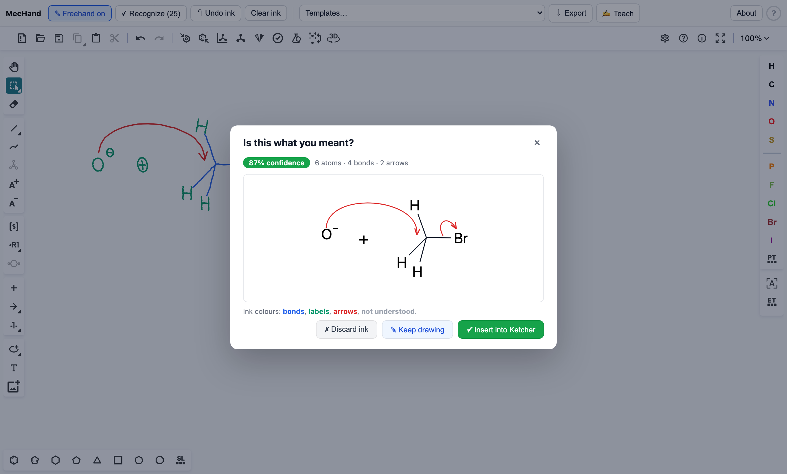
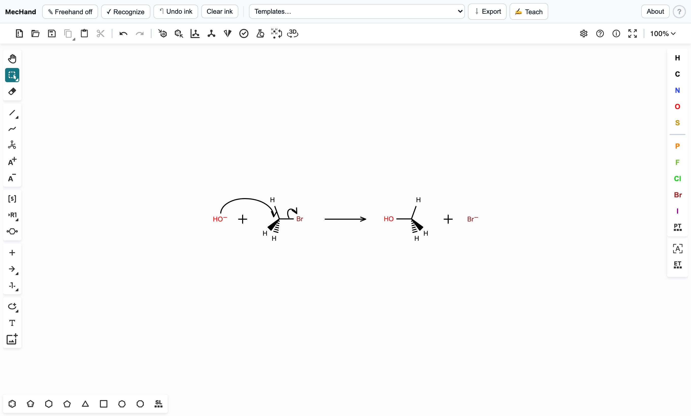

# MecHand

> Draw reaction mechanisms by hand. MecHand recognizes them in your browser, checks the electron
> flow, and exports them to LaTeX, ChemDraw and Marvin.

**▶ Open MecHand: <https://jordivillafreixa.github.io/MecHand/app/>** ·
[Website and documentation](https://jordivillafreixa.github.io/MecHand/) ·
[Tutorial (PDF)](https://jordivillafreixa.github.io/MecHand/tutorial.pdf)



MecHand is a freehand layer on top of the [Ketcher](https://github.com/epam/ketcher) chemical
editor. Sketch structures, charges and curved arrows with a pen, a trackpad or a mouse; MecHand reads
your strokes, shows what it understood, and inserts a clean, editable structure with its
electron-flow arrows into Ketcher.

- **Handwriting recognition in the browser.** Nothing to install, no server, nothing leaves your computer.
- **Electron-flow checks** for every curved arrow (lone pair at the start, octet at the end).
- **Export** to TikZ (curved arrows as Bézier curves), chemfig, CDXML (ChemDraw), MOL/RXN (Marvin, RDKit), KET and SMILES.
- **13 standard mechanisms** from organic, inorganic and biological chemistry, as templates.
- **An open, updatable symbol model**: teach MecHand your handwriting and contribute samples back.
- Works in **Chrome, Edge, Firefox and Safari**, on computers and tablets (Apple Pencil, S Pen…).

**Status:** pre-publication (manuscript in preparation for *Journal of Cheminformatics*).
**Licence:** MIT (MecHand) · Apache 2.0 (Ketcher, used as an npm dependency).

---

## Contents

- [Quick start](#quick-start)
- [Drawing mechanisms](#drawing-mechanisms)
- [How handwriting recognition works](#how-handwriting-recognition-works)
- [Templates](#templates)
- [Export](#export)
- [Browser support](#browser-support)
- [Optional recognition server (DECIMER)](#optional-recognition-server-decimer)
- [Ideas taken from ChemDraw and Marvin](#ideas-taken-from-chemdraw-and-marvin)
- [Repository layout](#repository-layout)
- [Development](#development)
- [Tutorial and manuscript](#tutorial-and-manuscript)
- [Citation](#citation)

---

## Quick start

### Online

Open **<https://jordivillafreixa.github.io/MecHand/app/>**. The first visit downloads about 9 MB
(mostly Ketcher's WebAssembly chemistry engine), which the browser then caches.

### On your own computer

You need [Node.js](https://nodejs.org) ≥ 20.19 (an LTS release is recommended). npm comes with
Node.js; yarn is not needed (Ketcher itself has moved from yarn to npm).

```sh
# Install Node.js
brew install node                    # macOS (Homebrew)
winget install OpenJS.NodeJS.LTS     # Windows
sudo apt install nodejs npm          # Debian/Ubuntu (or use the installers at nodejs.org)

# Get and run MecHand
git clone https://github.com/JordiVillaFreixa/MecHand.git
cd MecHand/ketcher-mechhand
npm ci                               # exact versions from package-lock.json
npm run dev                          # → http://localhost:5173
```

`npm run build` produces a static site in `ketcher-mechhand/dist/` that any web server can host.

---

## Drawing mechanisms



1. Press **✎ Freehand** (Alt/⌥+F) and draw on the canvas as on paper.
2. Press **✓ Recognize** (Space). Your ink is coloured by how it was read — blue bonds, green labels,
   red arrows, grey not understood — and a clean drawing of the result is shown with its confidence
   and any electron-flow warnings.
3. **✓ Insert into Ketcher**, **✎ Keep drawing** (to fix strokes), or **✗ Discard ink**.

| You draw | MecHand reads |
| --- | --- |
| A line; a zig-zag or a closed polygon in one stroke | bonds; a chain or a ring |
| Two or three close parallel lines | a double or triple bond |
| Letters at a bond end, or on their own | atom labels: C, H, N, O, S, P, F, Cl, Br, I, B, Si, Li, Na, K, Mg, Al, Fe, Cu, Zn, Pt, Pd… |
| `+`, `−`, ⊕, ⊖, `2−`, `3+` at the upper right of an atom | a formal charge |
| A single dot next to an atom | a radical |
| `+` between molecules | a reaction plus sign |
| A curve with a full head (drawn with the curve or separately) | an electron-pair arrow |
| A curve with a single barb | a single-electron (fishhook) arrow |
| A long straight arrow | a reaction arrow |

Draw bonds two or three times longer than letters are tall and leave a small gap between a bond and
its label. Start a curved arrow at the electrons (a lone pair or the middle of a bond) and end it at
the atom or bond that receives them.

**Electron-flow check.** Each curved arrow is anchored to the nearest atom or bond, and MecHand warns
when an electron-pair arrow starts at an atom without a lone pair, when an arrow starts or ends on
nothing, or when it would give C, N, O or F more than an octet while no bond to that atom breaks.

| Keys | Action |
| --- | --- |
| Alt+F (⌥F on a Mac) | Freehand on/off |
| Space | Recognize (freehand mode) |
| Ctrl+Z / ⌘Z | Remove the last stroke (freehand mode; otherwise Ketcher's undo) |
| Esc | Close a dialog |

More in the [guide](https://jordivillafreixa.github.io/MecHand/guide/drawing) and the
[tutorial](https://jordivillafreixa.github.io/MecHand/tutorial.pdf).

---

## How handwriting recognition works

MecHand reads **strokes** (pen positions, stroke order and endpoints), not pictures, which makes a
light-weight, transparent recognizer possible that runs entirely in the browser. Source:
[`ketcher-mechhand/src/recognition/`](ketcher-mechhand/src/recognition/).

1. **Scale** — the drawn bond length *L* is estimated from straight strokes and from letter height;
   all later decisions are relative to *L*.
2. **Arrows** — strokes with an arrowhead (a sharp turn back at the end, or a separate small V or barb).
   Curved → electron-flow arrow (full head 2 e⁻, single barb 1 e⁻); long and straight → reaction arrow.
3. **Letters vs bonds** — short strokes that cross (+, H), meet in a T (H, F), meet at an acute angle
   (N, M, Z; bonds never meet below 60°) or stand beside a letter (the l of Cl) are letters; long
   straight strokes, zig-zags and polygons are bonds, split at their corners with **ShortStraw**
   (Wolin, Eoff & Hammond, 2008).
4. **Labels** — characters are classified with the **$P point-cloud recognizer** (Vatavu, Anthony &
   Wobbrock, ICMI 2012), independent of stroke order and direction; a decoder picks the best
   chemically valid reading ("Cl", "O−", "Pt2−").
5. **Graph** — parallel lines become double/triple bonds, bond ends become atoms, labels and charges
   attach to the nearest atom (charges prefer the upper-right position).
6. **Electron flow** — arrows are anchored to atoms/bonds and checked; the result is sent to Ketcher
   as KET, with curved arrows as Ketcher elliptical-arc arrows.

### The model, and how to update it

| Where | What |
| --- | --- |
| [`src/recognition/model/symbols-model.json`](ketcher-mechhand/src/recognition/model/symbols-model.json) | Versioned glyph skeletons (letters, digits, + and −), expanded at start-up into slanted, scaled, rotated and jittered variants. |
| [`src/recognition/model/contrib/`](ketcher-mechhand/src/recognition/model/contrib/) | Real handwriting samples contributed by users. |
| Your browser | Samples recorded with **✍ Teach** (applied immediately). |

To improve the model for everyone: record samples with ✍ Teach → **Export samples**, put the JSON
file in `model/contrib/`, bump `version` in `symbols-model.json`, and open a pull request. The model
version in use is shown in **About**. The recognizer has no runtime dependencies and is updated,
tested and deployed with the rest of the app.

### Accuracy

Each template is rendered as synthetic handwriting in three styles (different slant, jitter, letter
shapes, and arrowheads drawn with the shaft or separately), recognized, and compared with the original:

| 13 templates × 3 styles (9 November 2026) | |
| --- | --- |
| Atoms (element and charge) | **87 %** |
| Bonds (connectivity and order) | **85 %** |
| Arrows (number and kind) | **100 %** |
| Whole mechanism exactly right | 31 % |

This benchmark runs with `npm test` and fails if accuracy drops. It is not a user study: real
handwriting varies more, which is why recognition always ends in a confirmation dialog. The weakest
cases are crowded metal complexes and labels with many explicit hydrogens.

---

## Templates

**Templates…** opens 13 textbook mechanisms (KET files in
[`ketcher-mechhand/src/templates/mechanisms/`](ketcher-mechhand/src/templates/mechanisms/)), generated
reproducibly with RDKit by [`templates/build_templates.py`](ketcher-mechhand/templates/build_templates.py),
which also checks that charges and atoms balance across each arrow.

| Organic | Inorganic | Biochemistry |
| --- | --- | --- |
| SN2 (HO⁻ + CH₃Br) | Lewis adduct NH₃ + BF₃ | Serine protease acylation (catalytic triad) |
| E2 (EtO⁻ + 2-bromopropane) | Associative substitution at Pt(II) | Alcohol dehydrogenase: hydride transfer to NAD⁺ |
| Cyanide addition to acetaldehyde | Hydrolysis of SiCl₄ | Kinase: in-line phosphoryl transfer |
| Aromatic nitration (Wheland ion) | Acidity of [Fe(OH₂)₆]³⁺ | |
| Diels–Alder | | |
| Cl₂ homolysis (fishhook arrows) | | |

References (Clayden; Housecroft & Sharpe; Berg/Tymoczko/Gatto/Stryer; Fersht) are listed on the
[templates page](https://jordivillafreixa.github.io/MecHand/guide/templates).

---

## Export

**⇩ Export** converts the whole canvas, curved arrows included:

| Format | Use |
| --- | --- |
| TikZ | Absolute coordinates; electron-pair arrows as cubic Bézier curves, fishhooks with half heads. Needs `\usepackage{tikz}` and `\usetikzlibrary{arrows.meta,bending}`. |
| chemfig | `\schemestart … \schemestop` scheme; curved arrows as `\chemmove` (compile twice). Needs `\usepackage{chemfig}` and `\usetikzlibrary{arrows.meta,bending,calc}`. |
| CDXML | ChemDraw (Marvin also reads it). |
| MOL / RXN | Marvin, ChemDraw, RDKit, Open Babel… |
| KET | Ketcher's native format; keeps everything. |
| SMILES | Structures only. |

The TikZ and chemfig exports of every template are compiled with pdflatex in the test suite
(`npm run test:latex`).

---

## Browser support

MecHand uses standard APIs only — Pointer Events (one code path for mouse, trackpad, pen and touch),
WebAssembly, Web Workers and SVG — and is tested automatically on every change in **Chromium,
Firefox and WebKit** with Playwright (open a template, draw a molecule with the pointer, recognize,
insert, export).

| Browser | Status | Notes |
| --- | --- | --- |
| Chrome / Edge (desktop) | ✅ | Reference platform |
| Firefox (desktop) | ✅ | |
| Safari 18.2+ (macOS) | ✅ | |
| Safari 16.4–18.1 | ⚠️ works | No `PointerEvent.getCoalescedEvents()` before 18.2: fewer points per stroke when drawing fast (more angular ink); recognition still works |
| Safari on iPad 18.2+ with Apple Pencil | ✅ | Pencil pressure is used; the palm is ignored once the Pencil has been used |
| Chrome on Android with a stylus | ✅ | |
| Firefox on Android | ⚠️ works | `getCoalescedEvents()` only partly implemented: slightly coarser ink |
| Internet Explorer, old Edge (EdgeHTML) | ❌ | No WebAssembly / modern JavaScript |

Feature support from MDN browser-compat-data 8.1.8 (November 2026). Known issues:

- **Pan/zoom while drawing.** In freehand mode touch and pen gestures draw (`touch-action: none`);
  turn freehand off (Alt/⌥+F) to pan or zoom with Ketcher.
- **Clipboard** copy needs https or localhost; otherwise use *Download* in the Export dialog.
- **Private windows** (especially Safari) may not keep ✍ Teach samples; use *Export samples*.
- **Optional server from the public site:** an https page calling `http://localhost:8000` is a
  local-network request. Chrome/Edge ask for permission once (allow it); Firefox allows it; Safari
  may block it as mixed content — then run MecHand locally (`npm run dev`) or serve the server over https.

---

## Optional recognition server (DECIMER)

Not needed for normal use. To compare with an image-based deep-learning model, MecHand can send a
picture of the ink to **DECIMER** (Rajan, Brinkhaus et al., *Nat. Commun.* 2023; hand-drawn model in
*J. Cheminform.* 2024) running on your computer. DECIMER returns the structure; arrows, charges and the
electron-flow check still come from MecHand.

Requires **Python 3.10–3.13** (TensorFlow 2.20 has no wheels for 3.14 yet):

```sh
cd backend
python3.13 -m venv .venv && source .venv/bin/activate     # Windows: .venv\Scripts\activate
pip install -r requirements.txt
uvicorn main:app --port 8000      # first start downloads the hand-drawn model (~285 MB)
# or: docker build -t mechand-server backend && docker run -p 8000:8000 mechand-server
```

Then choose **About → Structure engine → DECIMER server** in MecHand (or open the app with
`?engine=server&server=http://localhost:8000`). Endpoints: `GET /health`, `POST /recognize`
(PNG → SMILES, molfile, atoms, bonds, confidence).

**Why not MolScribe?** Earlier drafts used MolScribe, whose last release (April 2023) pins
OpenNMT-py 2.2, torchtext 0.5 and pyonmttok 1.x; these no longer install on current Python versions or
on Apple Silicon (`No matching distribution found for pyonmttok`), and MolScribe is weak on hand-drawn
structures. DECIMER is maintained (2.8.1, October 2026), installs with plain `pip`, and has a
hand-drawn model.

---

## Ideas taken from ChemDraw and Marvin

| Feature | In ChemDraw / Marvin | In MecHand |
| --- | --- | --- |
| Electron-flow arrows attached to lone pairs/bonds, with rules on valid sources and targets | Marvin JS electron-flow arrows | Arrows anchored to atoms/bonds automatically + electron-flow check |
| Curved-arrow mechanisms with full and half heads | Both | Recognized from handwriting; exported to TikZ/chemfig |
| Template libraries | Both (ring and structure templates) | Mechanism templates (organic, inorganic, biochemistry) — Ketcher also has ring/functional-group templates |
| Structure clean-up, valence checks, stereo labels, calculated properties | Both | Provided by Ketcher (Layout, Clean up, Check structure, Calculated values) |
| File interchange | CDXML / MRV | Export CDXML, MOL/RXN, KET, SMILES; Ketcher opens CDXML, CDX, MOL, RXN, SMILES |
| Freehand drawing with recognition | — | MecHand's own contribution |
| Publication-ready LaTeX | — | TikZ and chemfig export |

Sources: [Marvin JS electron-flow arrows](https://docs.chemaxon.com/Electron_Flow_Arrows.html),
[Reactions and mechanisms in Marvin JS](https://docs.chemaxon.com/Reactions_and_Mechanisms_in_Marvin_JS.html).

---

## Repository layout

```
MecHand/
├── ketcher-mechhand/        the web app (Vite 8 + React 19 + TypeScript; Ketcher 3.18.0 from npm)
│   ├── src/ink/             pen input and the ink layer
│   ├── src/recognition/     handwriting recognizer, $P model, electron-flow check
│   ├── src/scene/           KET ⇄ Scene conversion
│   ├── src/export/          TikZ and chemfig exporters
│   ├── src/templates/       mechanism templates (KET) and index
│   ├── src/ui/              toolbar and dialogs
│   ├── templates/           build_templates.py (RDKit)
│   └── e2e/                 Playwright tests (Chromium, Firefox, WebKit)
├── backend/                 optional DECIMER server (FastAPI, Python 3.10–3.13)
├── docs/                    website (VitePress) — screenshots, tutorial PDF
├── tutorial/                user tutorial (LaTeX + Makefile)
├── manuscript/              Journal of Cheminformatics manuscript (LaTeX + Makefile)
└── .github/workflows/       CI (tests in three browsers) and GitHub Pages deployment
```

---

## Development

```sh
cd ketcher-mechhand
npm ci
npm run dev            # app at http://localhost:5173
npm run typecheck      # TypeScript
npm test               # unit tests + recognition benchmark + exporter tests
npm run test:latex     # compiles every template's TikZ/chemfig export (needs pdflatex)
npx playwright install && npm run e2e     # browser tests (Chromium, Firefox, WebKit)

cd ../backend && pip install -r requirements-dev.txt && pytest     # server API (fake model)
cd ../docs && npm ci && npm run dev                                # website
```

**Ketcher** is a pinned npm dependency (`ketcher-core`, `ketcher-react`, `ketcher-standalone`), not a
copy of its code. Update it with `npm install --save-exact ketcher-core@<v> ketcher-react@<v>
ketcher-standalone@<v>` and run the tests.

**Continuous integration** (`.github/workflows/ci.yml`) runs the type check, unit tests and benchmark,
the LaTeX compile check, the browser tests in all three engines and the server tests on every push.
**Deployment** (`.github/workflows/pages.yml`) builds the app and the website and publishes them on
GitHub Pages from `main`.

On a Mac, Playwright's WebKit does not receive mouse events while the display is asleep; keep it awake
with `caffeinate -u -t 600 &` when running the browser tests locally.

---

## Tutorial and manuscript

```sh
cd tutorial   && make          # mechand-tutorial.pdf   (make publish → docs/public/tutorial.pdf)
cd manuscript && make          # main.pdf (downloads the Springer Nature template on first run)
```

Both use `latexmk`; `make view`, `make clean` and `make distclean` are also available. The tutorial's
figures are MecHand's own TikZ/chemfig exports (`make figures` regenerates them).

---

## Citation

> J. Villà-Freixa. MecHand: Freehand Chemical Mechanism Drawing with Sketch Recognition and Direct
> Export to LaTeX. *J. Cheminformatics* (in preparation).

## Author

**Jordi Villà-Freixa** · ORCID [0000-0002-6359-3929](https://orcid.org/0000-0002-6359-3929) · [jordi.villa@uvic.cat](mailto:jordi.villa@uvic.cat)

1. Department of Biosciences, University of Vic - Central University of Catalonia (UVic-UCC), Vic, Spain
2. IRIS-CC (Institut de Recerca i Innovació en Ciències de la Vida i de la Salut a la Catalunya Central), Vic, Spain
3. Computational Biochemistry and Biophysics Lab, Research Group on Bioinformatics and Bioimaging (BI-SQUARE), Universitat de Vic - Universitat Central de Catalunya (UVic-UCC), Vic, Spain
