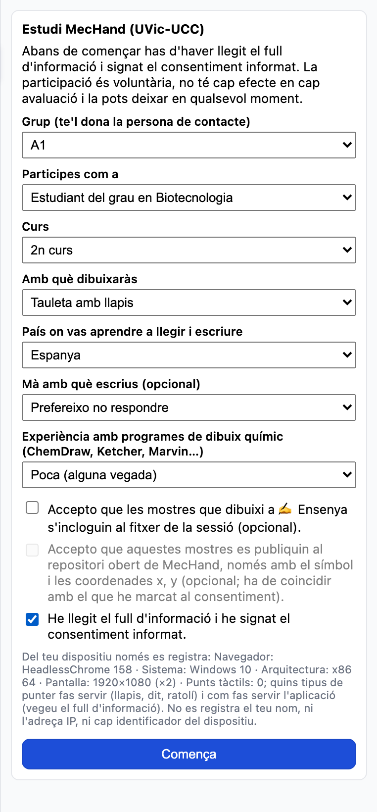
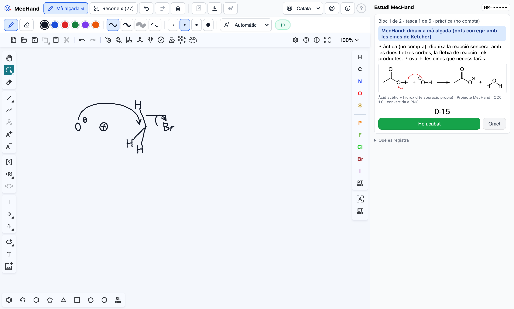

Gràcies per participar! La sessió dura uns **60 minuts**. No és cap examen: avaluem l'eina, no tu.

# Abans de començar

1. Llegeix el full d'informació i signa el consentiment (dues còpies: una és per a tu).
2. Obre l'adreça que et donarà la persona de contacte (p. ex. `http://192.168.1.20:4173/?study=1&group=A1`)
   amb el navegador del teu dispositiu. Funciona amb Chrome, Edge, Firefox i Safari, en ordinador o
   tauleta. A la dreta veuràs el panell **Estudi MecHand**.

{width=45%}

3. Omple les preguntes del panell. El **grup** ja hi surt o te'l diu la persona de contacte. Les dues
   caselles sobre les mostres d'entrenament són opcionals i han de coincidir amb el que has marcat al
   consentiment. Marca que has signat el consentiment i prem **Comença**.

# 1. Entrenament (≈ 10 minuts)

L'aplicació es mostra en català. Prem **Obre ✍ Ensenya**. En cada pestanya, tria un element,
dibuixa'l al requadre i prem **Desa la mostra** (**Desfés el traç** esborra l'últim traç). Sota el
requadre veuràs com ho llegeix MecHand («Ara es llegeix com»): si l'encerta (✓), n'hi ha prou amb una
o dues mostres. Desa unes **3 mostres** de:

- *Lletres i signes*: C, O, N, H, F, l (de Cl), r (de Br), a (de Na), + i −; i també ⊕ i ⊖ si
  acostumes a escriure les càrregues encerclades;
- *Fletxes*: fletxa corba de 2 electrons, fletxa de reacció, equilibri (⇌);
- *Electrons*: parell solitari.

A les pestanyes de fletxes i electrons, la línia grisa marca la llargada d'un enllaç: dibuixa a aquella
escala. Quan acabis, tanca la finestra (Esc) i prem **He acabat l'entrenament**.

# 2. Tasques (2 blocs de 5 tasques)

Per a cada tasca, el panell mostra una imatge (fes-hi clic per ampliar-la) i què has de dibuixar.
Llegeix bé l'enunciat: en alguns mecanismes només cal dibuixar una part de la imatge, i on hi ha una
**R** has de posar-hi un **CH₃** (n'hi ha prou amb l'extrem d'una línia).

{width=100%}

1. Prem **Comença la tasca** (comença el cronòmetre).
2. Dibuixa-ho al llenç de Ketcher, a l'esquerra, de la manera que indica el requadre de color:

   - **MecHand: dibuix a mà alçada.** Prem el botó del bolígraf, **Mà alçada** (o Alt+F). Apareix una
     segona barra amb les eines de tinta (vegeu més avall). Dibuixa amb el llapis, el dit, el ratolí o
     el trackpad i prem **Reconeix** (o la barra d'espai). Revisa el que ha reconegut a la finestra
     «És això el que volies dir?» i prem **Insereix a Ketcher** si és correcte (o Retorn), **Continua
     dibuixant** (Esc) per corregir traços o **Descarta la tinta** per esborrar-la i tornar-hi. Pots
     acabar de corregir amb les eines de Ketcher, que són en anglès.
   - **Només eines de Ketcher.** El dibuix a mà alçada està desactivat: fes servir les eines de la
     barra de Ketcher (enllaços, àtoms, càrregues amb «A+» i «A−», fletxes). Les fletxes corbes són a
     l'eina de fletxes: «Arrow Elliptical Arc Open Angle» (2 e⁻) o «… Open Half Angle» (1 e⁻).

3. Quan el dibuix estigui com a la imatge, prem **He acabat**. Si una tasca se't fa impossible, prem
   **Omet**.

La primera tasca de cada bloc és de **pràctica** (una reacció àcid-base amb dues fletxes corbes):
aprofita-la per provar les eines. Treballa al teu ritme però sense entretenir-te: no cal que el
dibuix tingui la mateixa disposició que la imatge, sinó els mateixos àtoms, enllaços, càrregues i
fletxes. Entre els dos blocs pots fer una pausa.

## La barra de tinta (dibuix a mà alçada)

| Control | Què fa |
| --- | --- |
| **Llapis** / **Goma** | Dibuixar o esborrar. La goma esborra traços sencers: passa-la per sobre dels traços (s'aclareixen) i aixeca-la. Tecles P i E. La punta d'esborrar d'alguns llapis (Surface, Wacom) també esborra. |
| Colors, tipus de línia i gruix | Només canvien l'aspecte de la tinta: el reconeixement no en depèn. |
| Mode d'entrada | **Automàtic** (per defecte): un cop fas servir el llapis, el dit i el palmell s'ignoren. **Només llapis**: només dibuixa el llapis. **Llapis i dit**: dibuixen tots dos. **Trackpad**: un clic comença el traç, el mous sense prémer i un altre clic l'acaba. |
| Indicador del dispositiu | Diu si el navegador ha vist un llapis, un dit o un ratolí/trackpad, i si l'ha ignorat. |
| Desfer, refer i paperera (barra de dalt) | Desfer o refer l'últim canvi a la tinta (Ctrl/⌘+Z, Ctrl/⌘+Maj+Z) o esborrar-la tota. |
| **Ajuda** (F1) | Obre el centre d'ajuda al costat del llenç, amb consells per al que estàs fent. |

**Consells per al dibuix a mà alçada:** dibuixa els enllaços amb traços rectes; deixa un petit espai
entre l'enllaç i la lletra de l'àtom; escriu les càrregues a dalt a la dreta de l'àtom; dibuixa la
punta de les fletxes en un traç a part o sense aixecar el llapis; i fes les fletxes corbes des d'un
parell d'electrons o un enllaç fins a l'àtom o l'enllaç de destinació.

# 3. Valoració i final

Després de cada bloc respondràs 10 preguntes breus (de l'1 al 5). Al final hi ha unes preguntes
opcionals sobre les dues maneres de treballar: **no hi escriguis dades personals**.

A la pantalla final:

1. Comprova que les teves opcions sobre les mostres d'entrenament coincideixen amb el consentiment.
2. Anota el teu **codi** (`MH-…`) **al full que et quedes** (no al full signat): el necessitaràs si
   mai vols retirar les teves dades.
3. Prem **Descarrega** i **copia tu mateix/a** el fitxer `mechand-estudi-MH-….json` a la memòria USB
   de l'estudi. **No l'enviïs per correu.**
4. Prem **Esborra les dades d'aquest navegador** i esborra el fitxer de la carpeta de baixades.

# Si alguna cosa no va

- Si la pàgina es recarrega, la sessió es recupera, però el dibuix de la tasca en curs es perd: torna a
  prémer **Comença la tasca** i torna-la a començar.
- Si no pots dibuixar: comprova que el bolígraf **Mà alçada** està activat (només en les tasques de
  MecHand) i que l'indicador de dispositiu no diu «ignorat»; si diu «Dit ignorat» i vols dibuixar amb
  el dit, tria el mode d'entrada **Llapis i dit**.
- **Amb un trackpad** (per exemple, d'un MacBook): tria el mode d'entrada **Trackpad** (clic – moure –
  clic), o mantén premut el trackpad mentre dibuixes.
- Avisa la persona de contacte per a qualsevol problema tècnic.
